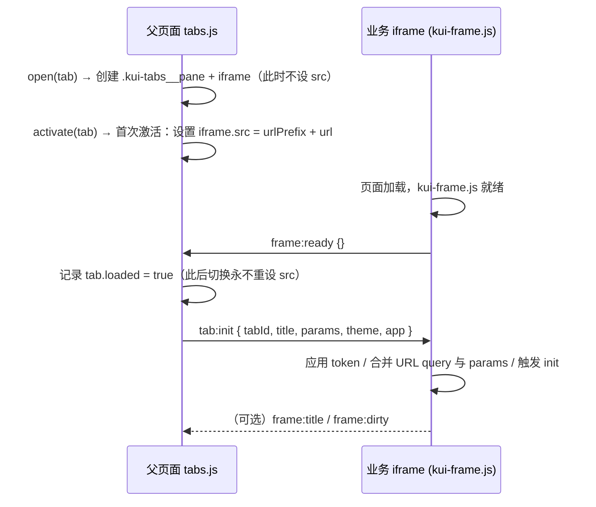
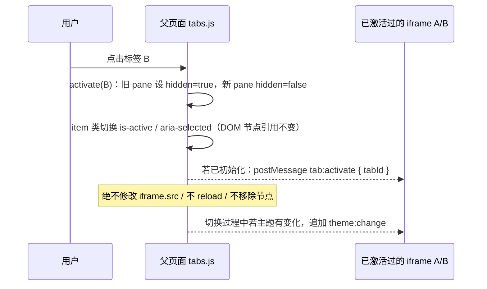
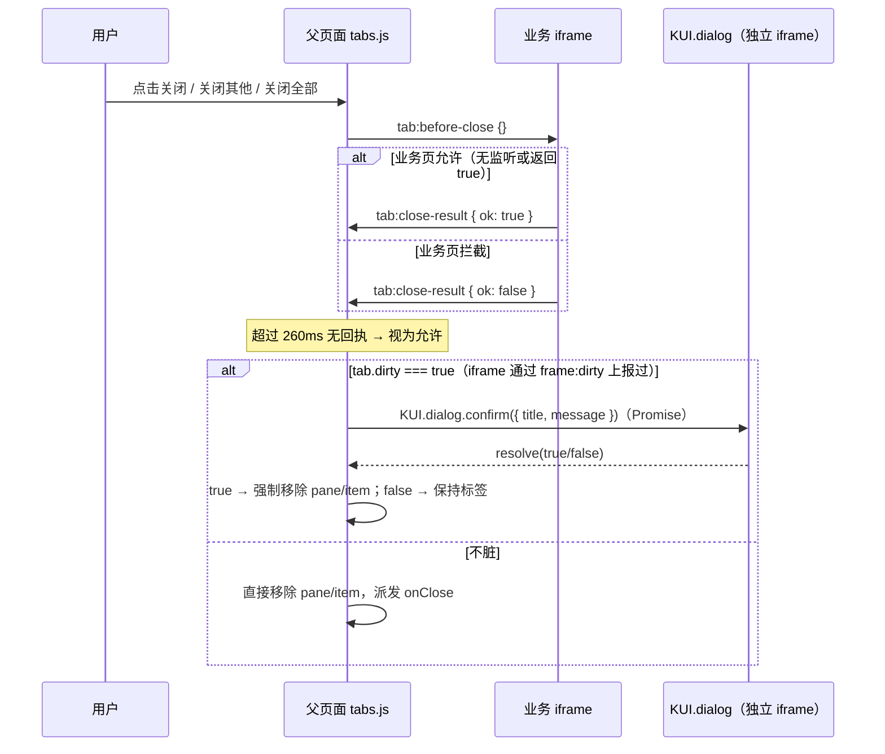
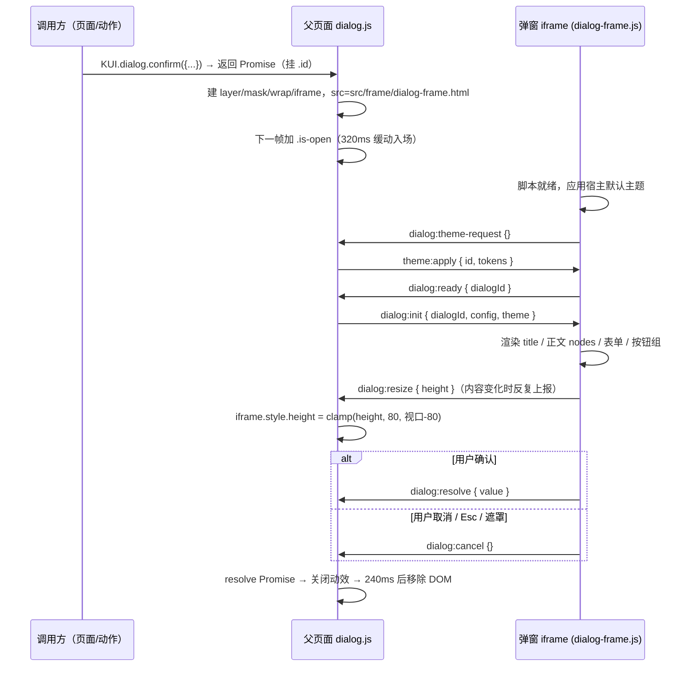
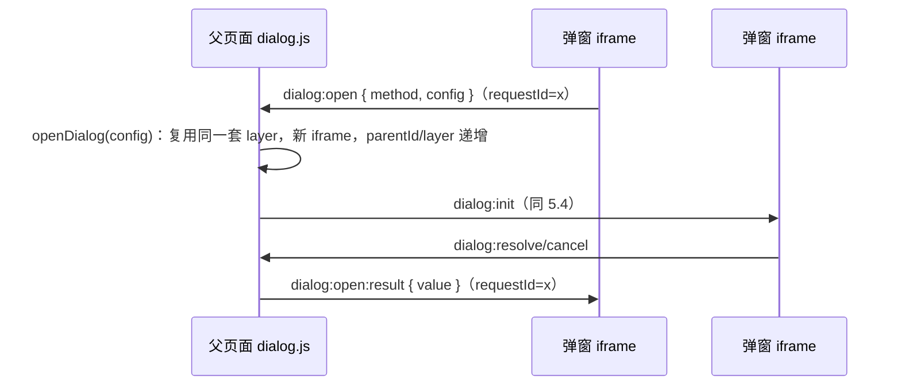
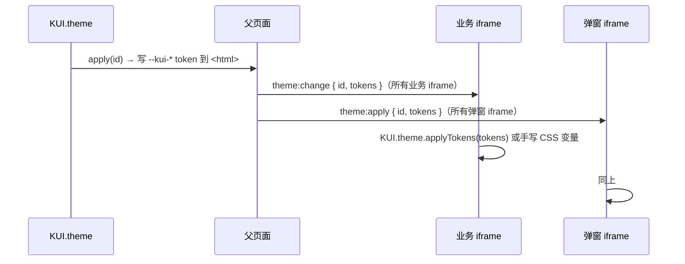

# 05 · 跨 iframe 消息协议（postMessage）

> 本文档是 `docs/00-contract.md` §9 的实现版说明书：契约给出消息名与字段，
> 本文记录**最终落地的完整消息表、配对规则、生命周期时序与排错清单**。
>
> 相关实现文件：
>
> | 文件 | 角色 | 发送 | 接收 |
> | --- | --- | --- | --- |
> | `src/components/tabs.js` | 标签容器（父页面） | `tab:init` / `tab:before-close` / `tab:refresh` / `tab:activate` / `theme:change` / `frame:dialog-result` / `frame:theme` / `frame:theme-request` | `frame:ready` / `frame:title` / `frame:dirty` / `frame:toast` / `frame:dialog` / `frame:close` / `frame:height` / `frame:navigate` / `tab:close-result` / `theme:apply` |
> | `src/components/dialog.js` | 弹窗容器（父页面） | `dialog:init` / `dialog:update` / `dialog:close` / `theme:apply` / `dialog:form-error` / `dialog:open:result` / `dialog:action:result` | `dialog:ready` / `dialog:resize` / `dialog:resolve` / `dialog:cancel` / `dialog:toast` / `dialog:open` / `dialog:theme-request` / `dialog:action` / `dialog:form-submit` / `dialog:drag-*` / `dialog:maximize` / `dialog:restore` / `dialog:close` |
> | `src/frame/kui-frame.js` | 业务页面 SDK（iframe 内） | `frame:ready` / `frame:title` / `frame:dirty` / `frame:toast` / `frame:dialog` / `frame:close` / `frame:height` / `frame:navigate` / `frame:theme` / `frame:theme-request` / `tab:close-result` / `frame:action` | `tab:init` / `tab:before-close` / `tab:refresh` / `tab:activate` / `theme:change` / `theme:apply` / `frame:dialog-result` / `frame:action` |
> | `src/frame/dialog-frame.js` | 弹窗内部渲染（iframe 内） | `dialog:ready` / `dialog:resize` / `dialog:resolve` / `dialog:cancel` / `dialog:toast` / `dialog:open` / `dialog:theme-request` / `dialog:action` / `dialog:form-submit` / `dialog:drag-*` / `dialog:maximize` / `dialog:restore` / `dialog:close` | `dialog:init` / `dialog:update` / `dialog:close` / `theme:apply` / `dialog:form-error` / `dialog:open:result` / `dialog:action:result` |

---

## 1. 消息信封

所有跨 iframe 消息共用一个信封（`tabs.js` / `dialog.js` / `kui-frame.js` / `dialog-frame.js` 完全一致）：

```js
{
  __kui: true,        // 命名空间标记，非框架消息直接忽略
  type: 'tab:init',   // 消息类型，见下文总表
  requestId: '',      // 需要请求/响应配对时非空，其余为空串
  payload: {}         // 业务负载，始终是普通对象（不传函数/HTMLElement）
}
```

**接收侧校验（硬性要求，四个文件都如此实现）：**

```js
// 父页面（tabs.js / dialog.js）
window.addEventListener('message', function (event) {
  var data = event.data;
  if (!data || data.__kui !== true) { return; }
  // 必须严格等于对应 iframe 的 contentWindow，杜绝任意窗口伪造消息
  if (event.source !== frameEl.contentWindow) { return; }
});

// iframe 内（kui-frame.js / dialog-frame.js）
if (event.source !== window.parent) { return; }
```

**发送侧 targetOrigin：** 统一使用 `'*'`。原因：本框架面向 `file://` 双击打开与任意 host 部署，
父页面无法预知 iframe 的实际 origin（`file://` 下 origin 为 `null`），任何具体 origin 字符串都会
让消息被静默丢弃。安全性由上面的 `event.source` 白名单校验保证；若部署环境能确定同源，
可将 `'*'` 收紧为 `window.location.origin`（四个文件的 `post` 函数都有该注释）。

---

## 2. 请求 / 响应配对

需要拿到返回值的消息，由**发起方**生成 `requestId` 并放在**信封**上；**响应方**把同一个
`requestId` 也放在**信封**上回传。四个文件的封装：

| 端 | 发送 | 接收 |
| --- | --- | --- |
| 父页面 → iframe | `post(frameEl, type, payload, requestId)` | `settle(requestId, ok, value)` |
| iframe → 父页面 | `post(type, payload, requestId)` / `request(type, payload)`（返回 Promise） | `settle(requestId, ok, value)` |

约定：

1. `requestId` 一律走信封字段，**不再**重复塞进 `payload`（早期草稿曾放 payload 内，现已统一）。
2. 响应消息的 `payload` 只承载结果值：
   - `frame:dialog-result` → `{ value }`
   - `dialog:open:result` → `{ value }`
   - `dialog:action:result` → `{ ok, result, error }`
3. `kui-frame.js` 的 `request()` 默认 **8s 超时**，超时 reject（`Promise` 拒绝，调用方需 `catch`）。
4. `dialog-frame.js` 的 `request()` 同样带超时；父级未响应时不会永久挂起。
5. 单向通知（`frame:dirty`、`dialog:toast`、`tab:activate` 等）`requestId` 为空。
6. **踩坑记录（协议历史 bug，均已修复；改动消息代码时务必复查）**：
   - **`requestId` 放错位置会让 Promise 永不 resolve。** 发起方必须把 `requestId` 放在**信封**上，响应方用
     `settle(data.requestId, ...)` 读取。历史上有两处误把它塞进 `payload`（`dialog:open:result`：
     dialog.js → dialog-frame；`frame:dialog-result`：tabs.js → kui-frame），导致嵌套弹窗与
     `KUI.frame.dialog.*` 的 Promise 永远挂起。排查方法：在 `settle` 里打印 `data.requestId` 是否为空。
   - **`dialog:open` 的 payload 是 `{ method, config }`，不是 config 本身。** 父级必须取 `payload.config`
     作为子弹窗配置，并在缺失时补 `type = payload.method`；若把整个 payload 当 config 传入，
     嵌套弹窗的 `type`/`title`/正文会全部错乱。
   - **弹窗层级不要硬编码。** `dialog.js` 从 `--kui-z-dialog` token 读基础层级（缺失回退 1200），
     再按打开顺序递增，避免主题或控件弹层（`--kui-popup-z`）打架。

---

## 3. 主框架 ↔ 弹窗 iframe（dialog）

每个弹窗都是**独立 iframe**（`src/frame/dialog-frame.html`），父页面只负责遮罩、定位、层级与动效。

### 3.1 父页面 → 弹窗 iframe

| type | payload | 时机 / 说明 |
| --- | --- | --- |
| `dialog:init` | `{ dialogId, config, theme: { id, tokens } }` | 收到 `dialog:ready` 后立即下发；`config` 已剔除函数字段（`onOk` / `onCancel` / `onClose` / `submitApi` 留在父页面执行） |
| `dialog:update` | `{ patch }` | 父页面调用 `KUI.dialog.update(id, patch)` 时增量下发；最大化切换也用它同步 `{ maximized }` |
| `dialog:close` | `{}` | 父页面主动关闭（`KUI.dialog.close(id)` / `closeAll()`） |
| `theme:apply` | `{ id, tokens }` | 主题切换、或应答 `dialog:theme-request` |
| `dialog:form-error` | `{ message }` | 父页面执行 `submitApi` 失败时回传，弹窗内显示错误并解除 loading |
| `dialog:open:result` | `{ value }` | 应答弹窗内发起的 `dialog:open`（嵌套弹窗关闭后的返回值），`requestId` 在信封 |
| `dialog:action:result` | `{ ok, result, error }` | 应答弹窗内发起的 `dialog:action`，`requestId` 在信封 |

### 3.2 弹窗 iframe → 父页面

| type | payload | 时机 / 说明 |
| --- | --- | --- |
| `dialog:ready` | `{ dialogId }` | iframe 脚本就绪。父页面收到后回 `dialog:init`，并移除骨架/loading；700ms 内未收到会重试（最多 6 次） |
| `dialog:resize` | `{ height, width? }` | 内容高度自适应：父页面写 `iframe.style.height`；仅当 `config.width === 'auto'` 时才使用 `width` |
| `dialog:resolve` | `{ value }` | 确认类操作（确定 / 提交成功）。父页面 resolve Promise 并关闭 |
| `dialog:cancel` | `{}` | 取消类操作（取消 / Esc / 关闭按钮）。父页面 resolve 为取消值（confirm→`false`，prompt/form→`null`，alert→`undefined`） |
| `dialog:toast` | toast 选项对象 | 弹窗内 `KUI.toast.*` 被代理到父页面执行，保证提醒显示在遮罩之上 |
| `dialog:open` | `{ method, config }` | 弹窗内再弹弹窗：请求父级新建**独立 iframe** 弹窗（`method` ∈ alert/confirm/prompt/form/custom）；`requestId` 在信封，父级以 `dialog:open:result` 回值 |
| `dialog:theme-request` | `{}` | iframe 就绪后主动请求当前主题，父级回 `theme:apply` |
| `dialog:action` | `{ action, params }` | 弹窗内动作向父级转发：父级 `KUI.actions.run()` 执行；`requestId` 在信封，父级回 `dialog:action:result`。**v1.0.2 起范围扩展到节点级 `on` 动作**：`dialog-frame.js` 的 `installActionBridge()` 包装本地 `KUI.actions.run`，凡 `app./theme./tab(s)./nav./menu./menunav./toast./dialog./handlers./form./frame.` 前缀一律转发（此前只有 footer 按钮转发，导致主题选择弹窗内的卡片点击无反应）。**v1.0.3 起改为「本地已注册则本地执行，其余一律转发」**（不再依赖前缀白名单，页面级自定义动作如 `demo.trace` 也能到达父页）；父页同样未注册时回执 `{ ok:false, error:"动作未注册：xxx" }` 并 `KUI.toast.warning` 可见提示，不再静默丢弃 |
| `dialog:form-submit` | `{ data }` | 表单弹窗提交时把数据交给父级 `submitApi`；`requestId` 在信封。父级定义 `submitApi` 返回 `false` 时保持弹窗打开，成功则 resolve 数据并关闭；失败回 `dialog:form-error` |
| `dialog:drag-start` | `{ x, y }` | 拖拽开始（iframe 内标题栏按下），父页面把 wrap 切换为 `position: fixed` 并记录起点 |
| `dialog:drag-move` | `{ x, y }` | 拖拽移动，父页面按屏幕坐标移动 wrap |
| `dialog:drag-end` | `{}` | 拖拽结束 |
| `dialog:maximize` | `{}` | 请求最大化 |
| `dialog:restore` | `{}` | 请求还原 |
| `dialog:close` | `{}` | 请求关闭（关闭按钮 / Esc / 取消），等价于 `dialog:cancel` + 关闭 |

> 嵌套弹窗的 Promise 结果由**父页面**转回发起 iframe：父级 `openDialog()` 的 Promise 结束后
> 以 `dialog:open:result { value }` 回传，因此「弹窗里再开弹窗」的返回值语义与主页面完全一致。

---

## 4. 主框架 ↔ 业务页面 iframe（tabs）

每个标签一个固定 `<iframe>`。**保活语义**：`pane` 与 `iframe` 创建后永不重建，
切换只切 `hidden` / `.is-active`；只有关闭标签才移除节点。刷新是唯一允许重设 `src` 的显式操作。

### 4.1 父页面（tabs.js）→ 业务 iframe

| type | payload | 时机 / 说明 |
| --- | --- | --- |
| `tab:init` | `{ tabId, title, params, theme: { id, tokens }, app: { title }, parentVersion, src }` | 收到 `frame:ready` 后下发；`params` 来自 `tabs.open({ params })`，不拼进 URL；`parentVersion`（v1.0.4 起）用于子页版本自愈，`src` 是该 iframe 的最终 URL（http(s) 下带 `kui_v` 版本戳） |
| `tab:before-close` | `{}` | 关闭标签前询问业务页是否允许关闭（脏数据拦截）。iframe 回 `tab:close-result { ok }`；**260ms** 无回执视为允许关闭 |
| `tab:refresh` | `{ tabId }` | 刷新当前标签；业务页收到后自行重载数据（不重载 iframe） |
| `tab:activate` | `{ tabId }` | 标签被切为激活态（包括保活切回），业务页可在此刷新可见区域/恢复动画 |
| `theme:change` | `{ id, tokens }` | 主题切换广播：父页面把新主题 id 与 token 快照推给所有业务 iframe |
| `frame:action` | `{ action, params }` | 扩展：父级要求业务页执行某个动作（`kui-frame.js` 已实现接收，当前框架未主动发送） |

### 4.2 业务 iframe（kui-frame.js）→ 父页面

| type | payload | 时机 / 说明 |
| --- | --- | --- |
| `frame:ready` | `{}` | 业务页脚本就绪（`KUI.frame.ready()`）。父页面收到后回 `tab:init`。就绪前发消息不会被丢弃：kui-frame 在 `DOMContentLoaded` 前排队，并在 600ms 间隔内最多重发 5 次 |
| `frame:title` | `{ title }` | 更新标签标题（`KUI.frame.setTitle()`，宿主页面标题同步） |
| `frame:dirty` | `{ dirty }` | 未保存状态变化（`KUI.frame.setDirty(true/false)`）。父页面在标签上显示脏数据圆点；关闭时触发 `KUI.dialog.confirm` 二次确认 |
| `frame:toast` | toast 选项对象 | 业务页 `KUI.frame.toast(...)` 转发父页面显示（父级 `KUI.toast`），保证堆叠在全局层 |
| `frame:dialog` | `{ method, config }` | 业务页请求弹窗（`KUI.frame.dialog.confirm(...)` 等）：父页面调用 `KUI.dialog[method](config)`，把结果以 `frame:dialog-result { value }` 回传；`requestId` 在信封 |
| `frame:close` | `{}` | 请求关闭自身标签（走完整关闭流程：before-close → dirty 确认） |
| `frame:height` | `{ height }` | 业务页内容高度上报（`KUI.frame.height()` / `heightAuto`），父页面可据此调整（不做自动撑满，保留 iframe 满铺语义） |
| `frame:navigate` | `{ tab }` | 请求打开/激活另一个标签：`tab` 形状与 `tabs.open()` 一致（`{ id, title, url, icon, pinned, params }`），父页面 `tabs.open` 或 `tabs.activate` |
| `tab:close-result` | `{ ok }` | 应答 `tab:before-close`：`ok:false` 表示拦截关闭（脏数据），其余视为允许 |
| `frame:action` | `{ action, params }` | 扩展：业务页请求父级执行动作（kui-frame 支持，当前未在业务页使用） |
| `frame:theme` | `{ id, name?, scheme?, tokens?, art? }` | **v1.0.1 新增**：业务页请求把全局主题同步到整壳与所有 iframe。父页面 `tabs.js` 调 `KUI.theme.apply(id, { persist: true })`，主题模块再广播 `theme:apply` 回所有子级；未知 id 但带 tokens 时先 `KUI.theme.register()` 再应用。业务页调用方式：`KUI.frame.setTheme(id)` |
| `frame:theme-request` | `{}` | **v1.0.1 新增**：业务页主动索取当前主题，父页面回 `theme:apply`（`KUI.frame.setTheme` 内部已自动处理首次同步） |

> **兼容别名**：`kui-frame.js` 同时接受 `frame:refresh` 作为 `tab:refresh` 的别名，供早期页面使用。

---

## 5. 生命周期时序

### 5.1 标签首次打开



关键点：`open()` 只建节点，**`activate()` 才设 src**。同一标签的 `src` 在整个生命周期内只设置一次；
`refresh()` 是唯一显式重设 `src` 的入口（且 `notifyOnly:true` 时只发 `tab:refresh`）。

### 5.2 标签切换（保活，核心验收点）



验收断言（`tools/smoke.js` 已覆盖）：
- 创建 → 切走 → 切回，`iframe` 节点引用完全一致；
- 同一标签 `src` 只被赋值一次；
- 未激活标签的 `pane` 带 `hidden`；
- 关闭标签才移除 `pane` 与 `item` 节点。

### 5.3 关闭未保存（dirty）标签



`KUI.dialog` 不可用时（未加载 dialog.js）降级为原生 `window.confirm`，保证关闭链路不断。

### 5.4 弹窗打开（含高度自适应）



- 焦点：父页面在 mask 与 iframe 之间做焦点回收，`focusin` 若落在弹窗外的父页面元素则拉回 iframe；
- 层级：`layer.style.zIndex = --kui-z-dialog + 递增步长`，多个弹窗按栈顺序重排 `.is-stacked`；
- 关闭值：`confirm → boolean`、`prompt → string | null`、`form → object | null`、`alert → undefined`、`custom → any`。

### 5.5 弹窗内再弹弹窗（嵌套）



任何层级的弹窗都是独立 iframe，不存在「弹窗内嵌 HTML 卡片」的分支。
`dialog:action` 同理：弹窗内无法本地执行的动作转发父级，父级回 `dialog:action:result`。

### 5.6 主题切换广播



### 5.7 toast 跨层

| 来源 | 路径 |
| --- | --- |
| 主页面 `KUI.toast.success(...)` | 直接渲染 `.kui-toast-layer` |
| 业务 iframe `KUI.frame.toast(...)` | `frame:toast` → 父页面 `KUI.toast.show(payload)` |
| 弹窗 iframe `KUI.toast.*`（被代理） | `dialog:toast` → 父页面 `KUI.toast.show(payload)` |
| 弹窗内表单提交成功等 | 弹窗内 `KUI.dialogFrame.toast(options)` 同样走 `dialog:toast` |

因此提醒永远出现在父页面图层，不会被遮罩盖住，也不会被 iframe 裁剪。

---

## 6. 全局事件（同页面，不是 postMessage）

组件实例事件与 `KUI.bus` 广播用于父页面内部联动（app-shell ↔ menu / menunav / tabs / dialog）：

| 事件 | 来源 | 说明 |
| --- | --- | --- |
| `menu:select` | menu | 菜单项点击（同时会调 `ctx.action(item.target)`） |
| `menu:collapsed` | menu | 折叠态变化，payload `{ collapsed }` 或布尔 |
| `tabs:open` / `tabs:close` / `tabs:activate` / `tabs:dirty` | tabs | 标签生命周期（app-shell 用于同步面包屑/历史按钮状态） |
| `tabs:contextmenu` / `tabs:action` | tabs | 右键菜单打开 / 右键动作执行 |
| `tabs:height` | tabs | `frame:height` 转发 |
| `dialog:open` / `dialog:close` / `dialog:maximize` | dialog | 弹窗生命周期（`KUI.bus`） |
| `theme:change` | KUI.theme | 主题变化，父页面据此广播给所有 iframe |

顶层页面也可用 `KUI.events.on('tabs:activate', fn)` 监听同一批事件。

---

## 7. 安全与限制

1. **来源校验**：父页面只接受 `event.source === 对应 iframe.contentWindow` 的消息；
   iframe 只接受 `event.source === window.parent`。任意第三方窗口/嵌套广告 iframe 无法注入消息。
2. **`__kui` 标记**：非本协议消息（第三方库、浏览器扩展）直接忽略，避免误判。
3. **targetOrigin `'*'`**：`file://` 与任意 host 部署下无法预知对方 origin，故统一 `'*'`；
   安全性由来源校验保证。同源部署可收紧（四个 `post` 函数都留有注释）。
4. **函数不可跨消息**：`config` 中的 `onOk` / `onCancel` / `onClose` / `submitApi` 只在父页面执行，
   下发给 iframe 前会被剔除（`serializeConfig`）。
5. **超时与降级**：
   - `tab:before-close` 260ms 超时 → 允许关闭；
   - `request()` 8s 超时 → Promise reject；
   - `KUI.dialog` / `KUI.toast` 缺失时自动降级为原生 `window.alert/confirm/prompt` 或空实现。
6. **iframe sandbox**：`tabs` 的 `sandbox` 默认**不设置**（空串），保证 `file://` 与需要
   `localStorage`/`document.title` 的业务页可用；如部署环境需要隔离，可在 `tabs` props 中显式传入
   sandbox 字符串（注意会禁用脚本以外的一些能力）。

---

## 8. 排错清单

| 现象 | 可能原因 | 排查 |
| --- | --- | --- |
| 业务页空白、收不到 `tab:init` | `frame:ready` 未发出或父页面尚未监听 | 确认页面引了 `../src/frame/kui-frame.js`，控制台看 `KUI.frame.isFramed()`；kui-frame 会重试 5 次 |
| 弹窗一直显示骨架 | `dialog:ready` 未回或 `dialog:init` 异常 | 检查 `dialog-frame.html` 相对路径（应为 `src/frame/dialog-frame.html`）、控制台 iframe 内错误 |
| 弹窗高度不跟随内容 | 内容变化但未触发 ResizeObserver / 未上报 | `dialog-frame.js` 有 ResizeObserver + MutationObserver，自定义动画需在结束后调用 `KUI.dialogFrame.resize()` |
| 切标签后页面状态丢失 | 组件被错误重建（违反保活） | 检查是否有代码在 `activate` 时重设 `iframe.src`；`refresh()` 是唯一允许重置 src 的入口 |
| 关闭脏标签没弹确认 | 业务页未调 `setDirty(true)`，或 `KUI.dialog` 未加载 | `KUI.frame.isDirty()` 自查；控制台看 `frame:dirty` 是否发出 |
| 弹窗内 toast 不显示 | `dialog:toast` 到达但父页面无 `KUI.toast` | `index.html` / standalone 页需引 `toast.js`（dialog 页建议同时引入） |
| 消息被静默忽略 | `event.source` 校验失败 / 信封缺 `__kui:true` | 在接收处临时打日志打印 `event.source === iframe.contentWindow` |
| 弹窗 Promise 永不 resolve / 返回值丢失 | 响应方把 `requestId` 放进了 `payload` 而不是信封 | 对端读的是信封 `data.requestId`；见 §2 第 6 条踩坑记录 |
| 嵌套弹窗类型/标题/正文错乱 | `dialog:open` 的 `payload.config` 未取出，整个 payload 被当成 config | 取 `payload.config`，缺失时补 `type = payload.method` |
| 弹窗与控件下拉层叠顺序错误 | `z-index` 被硬编码 | 统一读 `--kui-z-dialog` token（缺失回退 1200），按打开顺序递增 |

---

## 9. 与契约 §9 的差异（已落地的扩展，均为向后兼容新增）

| 新增消息 / 字段 | 方向 | 原因 |
| --- | --- | --- |
| `dialog:update` / `dialog:form-error` / `dialog:maximize` / `dialog:restore` / `dialog:drag-start|move|end` | 父 ↔ 弹窗 | 实现 `update()`、表单提交失败回显、拖拽与最大化（契约只列出核心五类） |
| `dialog:open` → `dialog:open:result`（`requestId` 配对） | 弹窗 ↔ 父 | 契约要求「弹窗内再弹弹窗转发父级」，需要返回值通道 |
| `dialog:action` → `dialog:action:result` | 弹窗 → 父 | 弹窗内动作统一由父页面 `KUI.actions.run` 执行，避免弹窗内重复实现动作表 |
| `frame:action` | 父 → 业务 | 反向动作通道（预留，当前未使用） |
| `frame:refresh` 别名 | 父 → 业务 | 兼容 `tab:refresh` 的旧命名 |
| `tab:activate` payload `{ tabId }` | 父 → 业务 | 保活切回时业务页需要知道「自己被重新激活」 |
